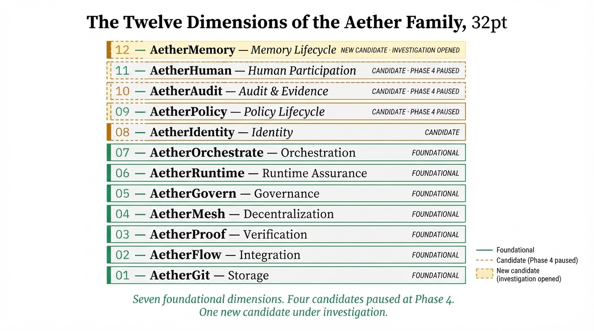
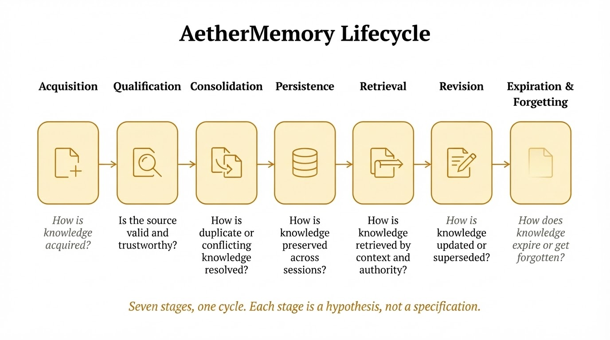
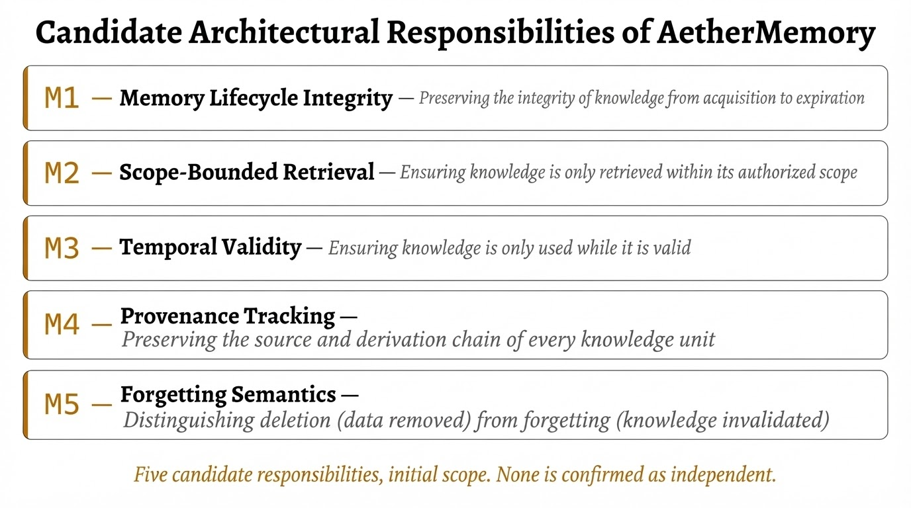
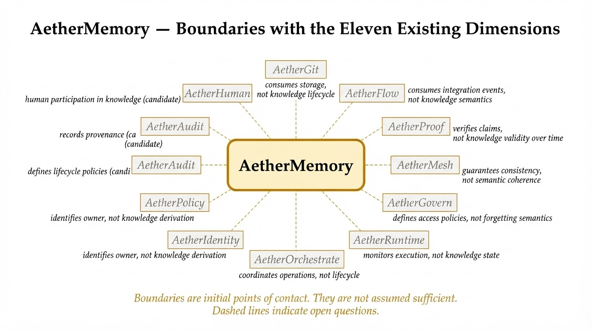
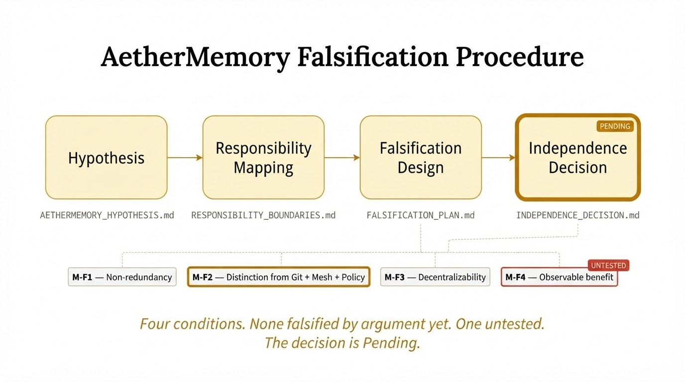
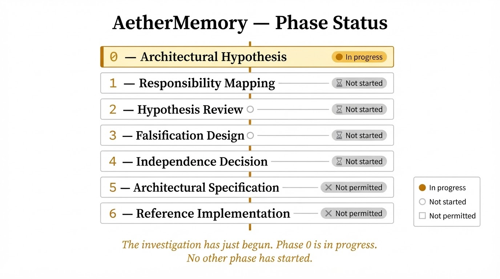
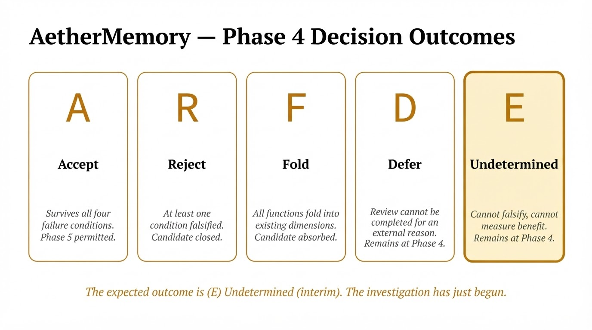
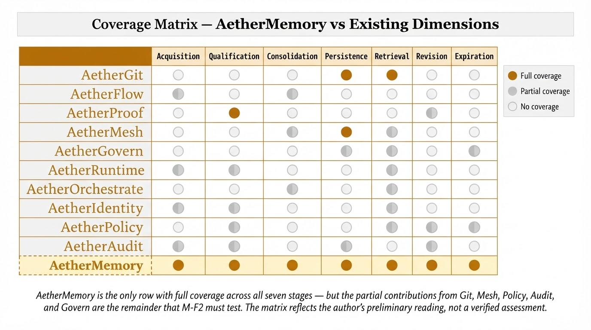
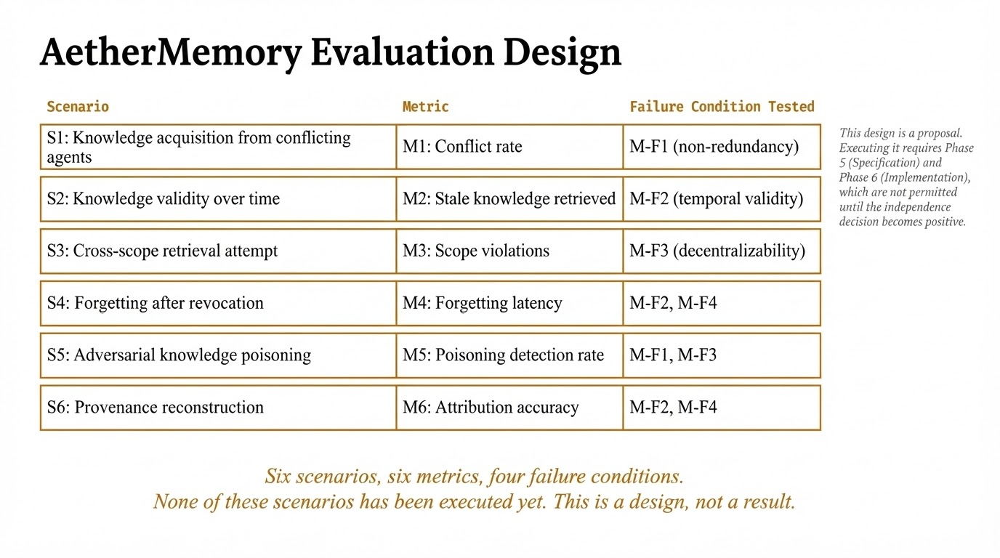

# AetherMemory — Architectural Hypothesis

**Status:** Hypothesis under investigation. Phase 0 — In progress. Not a committed project.
**Position in the Aether family:** Twelfth project (candidate).
**Date:** 2026-11-19
**Version:** 1.0.0
**Author:** Samir Baladi
**ORCID:** [0009-0003-8903-0029](https://orcid.org/0009-0003-8903-0029)
**License:** CC-BY-4.0 (this document)

---

## 0. Status of this document

This document states a hypothesis. It does **not** state a result.

- It does **not** claim that AetherMemory is an independent architectural dimension.
- It does **not** claim that the gap it describes is genuine.
- It does **not** claim that the boundaries with AetherGit, AetherMesh, AetherGovern, AetherPolicy, AetherAudit, and the other dimensions are sufficient.
- It does **not** authorize implementation.

The next steps are: review of this hypothesis, review of the responsibility boundaries, definition of falsification conditions, and a decision on architectural independence. Only after that decision may specification or implementation begin.

---

## 1. Position in the Aether family

The Aether family currently has **seven foundational dimensions** and **five candidates** (including AetherMemory):

| # | Project | Status |
|---|---|---|
| 1 | AetherGit | Foundational |
| 2 | AetherFlow | Foundational |
| 3 | AetherProof | Foundational |
| 4 | AetherMesh | Foundational |
| 5 | AetherGovern | Foundational |
| 6 | AetherRuntime | Foundational |
| 7 | AetherOrchestrate | Foundational |
| 8 | AetherIdentity | Candidate (independence unresolved) |
| 9 | AetherPolicy | Candidate (Phase 4: undetermined; paused) |
| 10 | AetherAudit | Candidate (Phase 4: undetermined; paused) |
| 11 | AetherHuman | Candidate (Phase 4: undetermined; paused) |
| 12 | **AetherMemory** | **Candidate (this document; Phase 0)** |

AetherMemory is the **twelfth project**. It is **not** a replacement for AetherGit, AetherMesh, AetherGovern, AetherPolicy, or AetherAudit, and it does **not** renumber any of them.

### 1.1 Structural dependency

AetherMemory is **structurally dependent** on the resolution of AetherPolicy and AetherAudit. Both are currently paused at Phase 4 with an (E) Undetermined (interim) decision.

- If AetherPolicy is folded into another dimension, the boundary between lifecycle policy and lifecycle integrity will need to be redrawn.
- If AetherAudit is folded, the boundary between provenance recording and provenance semantics will need to be redrawn.

This dependency is treated as a threat to validity (T3), not as a detail.

---

## 2. Central question

> **How can persistent knowledge in autonomous multi-agent systems be managed across its complete lifecycle — acquisition, qualification, consolidation, persistence, retrieval, revision, and expiration — without reducing it to data storage or losing semantic integrity?**

This is the initial central question. It is subject to revision after the hypothesis review.

The question carries four clauses:

| Clause | Condition |
|---|---|
| (i) Not already covered by Git / Mesh / Policy / Audit | M-F1 |
| (ii) Does not decompose into Git + Mesh + Policy + Audit | M-F2 |
| (iii) No central memory authority required | M-F3 |
| (iv) Observable benefit | M-F4 |

A positive answer needs all four. A negative answer on any one is sufficient to reject the candidate as a separate dimension, although it might survive as a feature of another.

---

## 3. The seven lifecycle stages (initial scope)

The following seven stages are proposed as the **initial scope**. They are not final requirements. Each is subject to falsification.

| # | Stage | Guiding question | Working definition (hypothesis) |
|:-:|---|---|---|
| **S1** | Acquisition | How is knowledge acquired? | Entry of a candidate knowledge unit from an agent, a human, or an external source. |
| **S2** | Qualification | Is the source valid and trustworthy? | Assessment of source validity and trust before a unit is accepted. |
| **S3** | Consolidation | How is duplicate or conflicting knowledge resolved? | Merging of duplicates and resolution of conflicts among units. |
| **S4** | Persistence | How is knowledge preserved across sessions? | Retention of a unit across sessions and executions. |
| **S5** | Retrieval | How is knowledge retrieved by context and authority? | Return of a unit scoped by context and by the authority of the requester. |
| **S6** | Revision | How is knowledge updated or superseded? | Update of a unit, or its replacement by a newer unit, with the earlier unit marked inactive. |
| **S7** | Expiration & Forgetting | How does knowledge expire or get forgotten? | Invalidation of a unit when it is no longer valid, distinguished from deletion of data. |

These seven stages are **not** assumed to be complete, independent, or necessary. A later phase may drop one, merge two, or add an eighth.

---

## 4. Five candidate responsibilities

Five responsibilities are proposed as the initial scope. None is confirmed as an independent architectural responsibility.

| ID | Responsibility | Statement (hypothesis) | Principal reduction risk |
|:-:|---|---|---|
| **M1** | Memory Lifecycle Integrity | Preserving the integrity of knowledge from acquisition to expiration. | May be a property of M2 to M5 taken together; composition of Policy and Audit (T3). |
| **M2** | Scope-Bounded Retrieval | Ensuring knowledge is only retrieved within its authorized scope. | May reduce to AetherGovern (T5). |
| **M3** | Temporal Validity | Ensuring knowledge is only used while it is valid. | Expiration rules may belong to AetherPolicy. |
| **M4** | Provenance Tracking | Preserving the source and derivation chain of every knowledge unit. | May reduce to AetherAudit. |
| **M5** | Forgetting Semantics | Distinguishing deletion (data removed) from forgetting (knowledge invalidated). | May be semantic: deletion plus audit plus retention rule (T4). |

---

## 5. Architectural hypothesis

> **A potentially independent architectural gap may exist between storage, consistency, policy, and audit: the management of persistent knowledge across its complete lifecycle — from acquisition through expiration — with semantic integrity preserved.**

This is a hypothesis. It is stated so that it can fail. Specifically:

- If **AetherGit** already provides all memory lifecycle requirements without an additional layer, the gap is not independent.
- If **AetherMesh plus AetherGit** cover the seven stages with bounded integration, the gap is not independent.
- If **AetherPolicy** already expresses the lifecycle rules (expiration, revision, forgetting) as policies, the gap is not independent.
- If **AetherAudit** already records all provenance and lifecycle history, the gap is not independent.
- If a **central memory authority** is required, decentralizability (M-F3) fails.
- If no **observable benefit** is demonstrated, M-F4 fails.

The hypothesis is falsified if any of the above holds.

---

## 6. Boundaries with the Aether family

The following boundaries are the **initial points of contact**. They are not assumed to be sufficient.

### 6.1 With the seven foundational dimensions

| Dimension | Responsibility | AetherMemory's relation |
|---|---|---|
| **AetherGit** | Storage and versioning | AetherMemory consumes storage; it does not store bytes. |
| **AetherFlow** | Integration | AetherMemory does not integrate. |
| **AetherProof** | Verification | AetherMemory consumes verification primitives for qualification; it does not prove. |
| **AetherMesh** | Decentralization | AetherMemory relies on Mesh for distribution; it does not distribute itself. |
| **AetherGovern** | Governance authority | AetherMemory consumes authority for scope-bounded retrieval; it does not issue it. |
| **AetherRuntime** | Runtime assurance | AetherMemory does not monitor execution. |
| **AetherOrchestrate** | Orchestration | AetherMemory does not orchestrate. |

### 6.2 With the four candidates

| Dimension | Responsibility | AetherMemory's relation |
|---|---|---|
| **AetherIdentity** | Determination of agent identity | AetherMemory uses identity to attribute provenance; it does not determine identity. |
| **AetherPolicy** | Policy evaluation and enforcement | AetherMemory consumes lifecycle policies; it does not evaluate them. |
| **AetherAudit** | Evidence and accountability | AetherMemory consumes audit records for provenance; it does not replace audit. |
| **AetherHuman** | Human participation | AetherMemory does not address human participation. |

### 6.3 Boundaries are not assumed sufficient

The boundaries are **not assumed to be sufficient**. A later phase must analyze whether:

- AetherGit's storage plus versioning already covers lifecycle persistence.
- AetherMesh's consistency already covers semantic coherence.
- AetherGovern's policies already cover scope-bounded retrieval.
- AetherPolicy's lifecycle rules already cover revision and expiration.
- AetherAudit's records already cover provenance tracking.
- The boundaries overlap in ways that make AetherMemory a feature, not a dimension.

---

## 7. Falsification-first methodology

AetherMemory follows the same falsification-first methodology as AetherHuman and AetherGovern:

1. **Architectural Hypothesis** (this document).
2. **Responsibility Mapping** — boundaries with the existing dimensions.
3. **Hypothesis Review** — independent review of the hypothesis and the boundaries.
4. **Falsification Design** — specific conditions under which AetherMemory does not deserve to be a separate dimension.
5. **Independence Decision** — a decision on whether the candidate is independent.
6. **Specification** — only if the independence decision is positive.
7. **Implementation** — only after specification.
8. **Evaluation** — only after implementation.

**No implementation begins before step 5.**

The falsification conditions will be designed **for AetherMemory**, not copied from AetherHuman's H-F1–H-F4. They will address:

- Whether the seven stages are already covered by AetherGit, AetherMesh, AetherPolicy, or AetherAudit.
- Whether lifecycle integrity can be reduced to existing storage, consistency, or policy mechanisms.
- Whether forgetting semantics can be expressed as a policy or requires a new primitive.
- Whether AetherMemory yields an observable benefit over existing mechanisms.

These are **directions**, not final conditions. The final conditions are set in step 4.

---

## 8. What this document does not claim

- That AetherMemory is an independent architectural dimension.
- That the seven lifecycle stages are complete.
- That the boundaries with AetherGit, AetherMesh, AetherGovern, AetherPolicy, AetherAudit, and the other dimensions are sufficient.
- That the gap is genuine.
- That implementation should begin.

This document claims only that the hypothesis is worth investigating under the stated methodology.

---

## 9. Next steps

In order:

1. **Responsibility mapping** of the seven stages against the existing dimensions.
2. **Independent review** of this hypothesis and the boundaries.
3. **Falsification conditions** designed for AetherMemory (M-F1 to M-F4).
4. **Independence decision**: is AetherMemory a separate dimension, a feature of AetherGit, a feature of AetherPolicy, a feature of AetherAudit, or a bounded extension of one of them?
5. **If independent**: specification (`SPECIFICATION.md`).
6. **If not independent**: report the result, and do not proceed to implementation.

Stopping after step 4 is a legitimate outcome.

---

## Appendix A — Relationship to existing Aether projects

| Project | Relation to AetherMemory |
|---|---|
| AetherGit | Storage of knowledge units (not lifecycle semantics) |
| AetherFlow | Integration events (not memory) |
| AetherProof | Verification of knowledge claims (not lifecycle) |
| AetherMesh | Distribution of knowledge (not semantic coherence) |
| AetherGovern | Authority for scope-bounded retrieval (not lifecycle policy) |
| AetherRuntime | Runtime state (not persistent memory) |
| AetherOrchestrate | Coordination of memory operations (not lifecycle) |
| AetherIdentity | Owner identity (not knowledge provenance) |
| AetherPolicy | Lifecycle policies (not lifecycle integrity) |
| AetherAudit | Provenance records (not forgetting semantics) |
| AetherHuman | Human participation (not memory management) |

This appendix is a hypothesis about relations. It is not a result.

---

## Appendix B — Open questions (initial)

- Q1. Is lifecycle integrity a property of the seven stages taken together, or of each stage separately?
- Q2. Can "forgetting" be expressed as a policy in AetherGovern, or does it require a new primitive?
- Q3. Can "provenance" be expressed as an audit record in AetherAudit, or does it require a new primitive?
- Q4. Can "scope-bounded retrieval" be expressed as an authorization decision in AetherGovern?
- Q5. Does the structural dependency on AetherPolicy and AetherAudit undermine the independence of AetherMemory?
- Q6. Is "staleness" a failure mode of storage, of consistency, or of memory lifecycle?
- Q7. What is the minimal interface between AetherMemory and AetherGit?
- Q8. What is the minimal interface between AetherMemory and AetherMesh?
- Q9. What is the minimal interface between AetherMemory and AetherPolicy?
- Q10. What is the minimal interface between AetherMemory and AetherAudit?

These are initial questions. They are not final.

---

## Appendix C — Figures

| # | Figure | Description |
|---|---|---|
| 1 |  | The twelve dimensions of the Aether family, with AetherMemory as candidate #12 |
| 2 |  | The AetherMemory lifecycle (seven stages) |
| 3 |  | The five candidate responsibilities (M1–M5) |
| 4 |  | AetherMemory and its boundaries |
| 5 |  | The falsification procedure (M-F1 to M-F4) |
| 6 |  | Phase status (Phase 0 in progress) |
| 7 |  | The five decision outcomes (A / R / F / D / E) |
| 8 |  | Coverage matrix: seven stages × existing dimensions |
| 9 |  | Evaluation design |

---

**AetherMemory v1.0.0 — Architectural Hypothesis**
© 2026 Samir Baladi — Ronin Institute / Rite of Renaissance
DOI: [10.6084/m9.figshare.35069155](https://doi.org/10.6084/m9.figshare.35069155)
