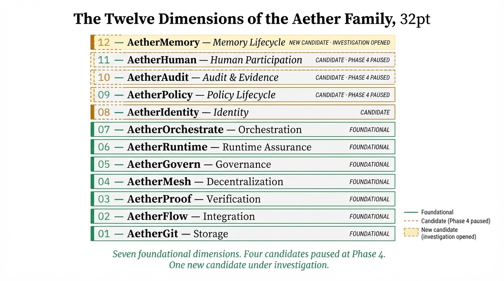

<div align="center">

# AetherMemory — Research Repository

### Memory Lifecycle Integrity in Autonomous Multi-Agent Systems

*A Falsification-First Investigation of Persistent Memory, Knowledge Validity, and Forgetting in Decentralized Agent Ecosystems*

<br>

[](https://doi.org/10.5281/zenodo.24372288)
[](https://doi.org/10.6084/m9.figshare.35069155)
[](https://creativecommons.org/licenses/by/4.0/)
[](https://orcid.org/0009-0003-8903-0029)


-orange)
[](https://aethermemory.netlify.app)

</div>

---

> [!IMPORTANT]
> **Status: Architectural Investigation (Phase 0).**
> This is a **research repository**, not a software repository. No implementation is planned unless the architectural investigation supports it.
>
> **Decision: (E) Undetermined (interim).** All four failure conditions are partial or untested.
> See [`DECISIONS/INDEPENDENCE_DECISION.md`](DECISIONS/INDEPENDENCE_DECISION.md).

> [!WARNING]
> **Structural Dependency:** AetherMemory is structurally dependent on the resolution of **AetherPolicy** and **AetherAudit**. Both are currently paused at Phase 4. Any conclusion about AetherMemory is conditional on how those two investigations resolve.

> *"AetherMemory is a candidate, not a result."*

---

## Table of Contents

- [Overview](#overview)
- [Central Question](#central-question)
- [Seven Lifecycle Stages](#seven-lifecycle-stages)
- [Candidate Responsibilities](#candidate-responsibilities)
- [Failure Conditions (M-F1 to M-F4)](#failure-conditions-m-f1-to-m-f4)
- [Propositions P1 and P2](#propositions-p1-and-p2)
- [Decision (Phase 0)](#decision-phase-0)
- [Repository Structure](#repository-structure)
- [Phase Status](#phase-status)
- [What This Repository Does Not Claim](#what-this-repository-does-not-claim)
- [Related Work](#related-work)
- [Related Aether Projects](#related-aether-projects)
- [Figures](#figures)
- [Figure Notes](#figure-notes)
- [Threats to Validity](#threats-to-validity)
- [Independent Review](#independent-review)
- [Citation](#citation)
- [Author](#author)
- [License](#license)

---

## Overview

**AetherMemory** is the **twelfth project (candidate)** of the Aether family. It investigates whether a genuine architectural gap exists between persistent knowledge management and the existing dimensions — particularly **AetherGit** (storage), **AetherMesh** (consistency), **AetherPolicy** (lifecycle policy), and **AetherAudit** (provenance).

**AetherMemory is not a replacement for AetherGit, AetherMesh, AetherPolicy, or AetherAudit.** All remain dimensions or candidates with their own status. AetherMemory investigates whether knowledge requires a distinct lifecycle (from acquisition to forgetting) that cannot be reduced to mere data storage or consistency.

This repository contains no `src/`, no `tests/`, and no `experiments/`. It will not contain them unless the investigation concludes that AetherMemory is independent.

| | |
|---|---|
| **Current release (v1.0.0)** | [Zenodo](https://doi.org/10.5281/zenodo.24372288) · [Figshare](https://doi.org/10.6084/m9.figshare.35069155) |
| **Length** | ~29 pages, ~11,000 words, 30 references |
| **PDF in this repo** | [`paper/AetherMemory_Research_Paper_v0.1.0.pdf`](paper/AetherMemory_Research_Paper_v0.1.0.pdf) |

---

## Central Question

> How can persistent knowledge in autonomous multi-agent systems be managed across its complete lifecycle — acquisition, qualification, consolidation, persistence, retrieval, revision, and expiration — without reducing it to data storage or losing semantic integrity?

The central question has four clauses, each mapped to a failure condition:

| Clause | Condition |
|---|:-:|
| (i) Not already covered by Git / Mesh / Policy / Audit | **M-F1** |
| (ii) Does not decompose into Git + Mesh + Policy + Audit | **M-F2** |
| (iii) No central memory authority required | **M-F3** |
| (iv) Observable benefit | **M-F4** |

A positive answer needs all four. A negative answer on any one is sufficient to reject the candidate as a separate dimension.

---

## Seven Lifecycle Stages

| Stage | Name | Guiding Question |
|:-:|---|---|
| **S1** | Acquisition | How is knowledge acquired? |
| **S2** | Qualification | Is the source valid and trustworthy? |
| **S3** | Consolidation | How is duplicate or conflicting knowledge resolved? |
| **S4** | Persistence | How is knowledge preserved across sessions? |
| **S5** | Retrieval | How is knowledge retrieved by context and authority? |
| **S6** | Revision | How is knowledge updated or superseded? |
| **S7** | Expiration and Forgetting | How does knowledge expire or get forgotten? |

These seven are **not** assumed to be complete, independent, or necessary.

---

## Candidate Responsibilities

| ID | Responsibility | Statement (Hypothesis) |
|:-:|---|---|
| **M1** | Memory Lifecycle Integrity | Preserving the integrity of knowledge from acquisition to expiration. |
| **M2** | Scope-Bounded Retrieval | Ensuring knowledge is only retrieved within its authorized scope. |
| **M3** | Temporal Validity | Ensuring knowledge is only used while it is valid. |
| **M4** | Provenance Tracking | Preserving the source and derivation chain of every knowledge unit. |
| **M5** | Forgetting Semantics | Distinguishing deletion (data removed) from forgetting (knowledge invalidated). |

These five are **not** assumed to be complete, independent, or necessary. None is confirmed as an independent architectural responsibility.

---

## Failure Conditions (M-F1 to M-F4)

| ID | Claim under test | Status |
|:-:|---|---|
| **M-F1** | Non-redundancy: not covered by Git / Mesh / Policy / Audit | 🟡 **Partial** (Git + Mesh); Policy/Audit open |
| **M-F2** | Distinction from Git + Mesh + Policy + Audit (a non-reducible remainder survives) | 🟡 **Partial**; remainder = state layer |
| **M-F3** | Decentralizability: no central memory authority required | 🟡 **Partial**; M3 (temporal validity) open |
| **M-F4** | Observable benefit | ⚫ **Not executable at Phase 0** (requires Phase 5 and 6) |

> [!NOTE]
> **"Partial" is a weaker status than "confirmed". "Not executable" is not a pass.**
>
> Decision rule: the candidate is accepted as an independent dimension only if all four conditions have been tested and none falsified, with M-F4 supported by measured results. The current evidence does not meet that threshold. The decision therefore remains **(E) Undetermined (interim)**.

---

## Propositions P1 and P2

| # | Proposition | Status |
|:-:|---|---|
| **P1** | Determinism of forgetting: a knowledge unit's expiration is a deterministic function of its lifecycle record | Proof sketch (not machine-checked) |
| **P2** | Irreducible distinction between deletion and forgetting: deletion removes data; forgetting invalidates knowledge while preserving provenance | Proof sketch (not machine-checked) |

Neither is machine-checked.

---

## Decision (Phase 0)

> [!WARNING]
> **AetherMemory is classified as (E) Undetermined (interim).**
> The evidence is insufficient to accept AetherMemory as an independent dimension, and insufficient to reject it.

Full record: [`DECISIONS/INDEPENDENCE_DECISION.md`](DECISIONS/INDEPENDENCE_DECISION.md).

| Why insufficient to **accept** | Why insufficient to **reject** |
|---|---|
| M-F1, M-F2, M-F3 are only partial. | No failure condition has been falsified. |
| M-F4 is not executable at Phase 0. | The lifecycle integrity question is coherent. |
| No implementation or experiment has been run. | The boundary map is drawable. |
| Structural dependency on AetherPolicy and AetherAudit (both unresolved). | Related work exists but does not settle the question. |

**"Undetermined" is not a failure.** It states that the evidence is insufficient to decide, and names what is missing.

---

## Repository Structure

```text
AetherMemory/
│
├── README.md
├── ARCHITECTURAL_HYPOTHESIS.md
├── ROADMAP.md
├── CHANGELOG.md
├── PROJECT_SUMMARY.txt
├── CITATION.cff
├── AUTHORS.md
├── CONTRIBUTING.md
├── INVENTORY.md
├── VERSION
├── manifest.json
├── scientific_state.json
├── netlify.toml
├── LICENSE
│
├── research/
│   └── RESPONSIBILITY_BOUNDARIES.md
│
├── FALSIFICATION/
│   ├── FALSIFICATION_PLAN.md
│   ├── M-F1_COVERAGE_ANALYSIS.md
│   ├── M-F2_COMPOSITION_ANALYSIS.md
│   ├── M-F3_DECENTRALIZATION_ANALYSIS.md
│   └── M-F4_STATUS.md
│
├── DECISIONS/
│   └── INDEPENDENCE_DECISION.md
│
├── REVIEW/
│   ├── INTERNAL_REVIEW.md
│   ├── INDEPENDENT_REVIEW.md
│   ├── INDEPENDENCE_DECLARATION.md
│   ├── INDEPENDENT_REVIEW_PROTOCOL.md
│   └── README.md
│
├── REFERENCES/
│   └── README.md
│
├── docs/
│   └── figures/
│       ├── Fig1_Twelve_Dimensions.png)
│       ├── Fig2_Memory_Lifecycle.png
│       ├── Fig3_Memory_Responsibilities.png
│       ├── Fig4_Boundaries.png
│       ├── Fig5_Falsification_Procedure.png
│       ├── Fig6_Phase_Status.png
│       ├── Fig7_Decision_Outcomes.png
│       ├── Fig8_Overlap_Matrix.png
│       └── Fig9_Evaluation_Design.png
│
├── paper/
│   └── AetherMemory_Research_Paper_v0.1.0.pdf
│
├── PUBLICATION/
│   └── Netlify/
│       └── public/
│
└── REPORTS/
    └── architectural_investigation/
        ├── investigation_report.md
        └── README.md
```

No src/, no tests/, no experiments/.

---

Phase Status

Phase Description Status
0 — Architectural Hypothesis The hypothesis is stated ✅ Complete (ARCHITECTURAL_HYPOTHESIS.md)
1 — Responsibility Mapping Boundaries with existing dimensions ✅ Complete (research/RESPONSIBILITY_BOUNDARIES.md)
2 — Hypothesis Review Independent review of hypothesis ✅ Complete (REVIEW/INDEPENDENT_REVIEW.md)
3 — Falsification Design Design of M-F1 to M-F4 tests ✅ Complete (FALSIFICATION/FALSIFICATION_PLAN.md + partial execution)
4 — Independence Decision (E) Undetermined (interim) ⚠️ Interim (DECISIONS/INDEPENDENCE_DECISION.md)
5 — Architectural Specification Requires positive Phase 4 ❌ Not permitted
6 — Reference Implementation Requires Phase 5 ❌ Not permitted

[!NOTE]
The independent review (REVIEW/INDEPENDENT_REVIEW.md) was completed and signed by external reviewer Jonathan Rabe on 2026-11-19. He confirmed the (E) Undetermined (interim) decision. Threat T2 is now resolved.

---

What This Repository Does Not Claim

· ✖ That AetherMemory is an independent architectural dimension.
· ✖ That the five lifecycle stages are complete, independent, or necessary.
· ✖ That the boundaries with AetherGit, AetherMesh, AetherPolicy, AetherAudit, and the other dimensions are sufficient.
· ✖ That the gap is genuine.
· ✖ That implementation should begin.
· ✖ Any observed benefit (M-F4 is not executable at Phase 0).
· ✖ Any causal effect.

---

Related Work

The paper cites 30 references. The nearest neighbours are recorded as reservations on M-F1, not as support for the candidate:

· Governed Shared Memory for Multi-Agent LLM Systems (arXiv 2026) — overlaps M2 (scope-bounded retrieval).
· IETF Persistent Memory Architecture (Internet-Draft) — overlaps M1 (lifecycle integrity).
· Microsoft Semantic Kernel memory abstractions — predominant practical framing (retrieval component).
· Production Memory Architecture (Tiwari, 2026) — four lenses and the distinction between retrieval relevance and current validity.
· Industry perspective (Kumar, 2026) — memory as a trust system, treated as motivation, not architectural evidence.

The comparison with the field is treated as open and is a reservation on M-F1.

---

Related Aether Projects

# Project Status DOI
1 AetherGit Foundational 10.5281/zenodo.23976986
2 AetherFlow Foundational 10.5281/zenodo.23979129
3 AetherProof Foundational 10.5281/zenodo.24013124
4 AetherMesh Foundational 10.5281/zenodo.24038038
5 AetherGovern Foundational 10.5281/zenodo.24054524
6 AetherRuntime Foundational 10.5281/zenodo.24078477
7 AetherOrchestrate Foundational 10.5281/zenodo.24095399
8 AetherIdentity Candidate 10.5281/zenodo.24102739
9 AetherPolicy Candidate (Phase 4: paused) 10.5281/zenodo.24160047
10 AetherAudit Candidate (Phase 4: paused) 10.5281/zenodo.24274628
11 AetherHuman Candidate (Phase 4: paused) 10.5281/zenodo.24315874
12 AetherMemory Candidate (this repository; Phase 0) Zenodo · Figshare

---

Figures

Figures 1–9 are described in the paper and stored in docs/figures/.

<details open>
<summary><b>Figure 1 — The Twelve Dimensions of the Aether Family</b></summary>
<br>



</details>

<details>
<summary><b>Figure 2 — AetherMemory Lifecycle (Seven Stages)</b></summary>
<br>

docs/figures/Fig2_Memory_Lifecycle.png

</details>

<details>
<summary><b>Figure 3 — Candidate Architectural Responsibilities (M1–M5)</b></summary>
<br>

docs/figures/Fig3_Memory_Responsibilities.png

</details>

<details>
<summary><b>Figure 4 — AetherMemory and Its Boundaries</b></summary>
<br>

docs/figures/Fig4_Boundaries.png

</details>

<details>
<summary><b>Figure 5 — The Falsification Procedure (M-F1 to M-F4)</b></summary>
<br>

docs/figures/Fig5_Falsification_Procedure.png

</details>

<details>
<summary><b>Figure 6 — Phase Status (Phase 0 in Progress)</b></summary>
<br>

docs/figures/Fig6_Phase_Status.png

</details>

<details>
<summary><b>Figure 7 — The Five Decision Outcomes (A / R / F / D / E)</b></summary>
<br>

docs/figures/Fig7_Decision_Outcomes.png

</details>

<details>
<summary><b>Figure 8 — Coverage Matrix: Seven Stages × Existing Dimensions</b></summary>
<br>

docs/figures/Fig8_Overlap_Matrix.png

</details>

<details>
<summary><b>Figure 9 — Evaluation Design: Scenarios × Metrics × Failure Conditions</b></summary>
<br>

docs/figures/Fig9_Evaluation_Design.png

</details>

---

Figure Notes

The paper notes the following observations about the supplied figures.

Figure Observation
Fig 1 A stray text fragment ("32pt") appears in the title; the legend labels candidates as "Candidate (Phase 4 paused)" while the AetherIdentity row is labelled only "Candidate". The caption speaks of four paused candidates, while only three rows carry that label.
Fig 2 The figure has no return arrow from expiration to acquisition. The lifecycle is treated as a sequence per knowledge unit; whether it is a cycle at the ecosystem level is not asserted.
Fig 8 The matrix reflects the author's preliminary reading, not a verified assessment. The partial contributions from other dimensions are the remainder that M-F2 must test.

---

Threats to Validity

# Threat Description
T1 Author-on-author reasoning The hypothesis and the decision are written by the same author.
T2 No independent review Resolved: independent external review completed and signed by Jonathan Rabe on 2026-11-19.
T3 Structural dependency on AetherPolicy and AetherAudit Both are paused at Phase 4; any conclusion is conditional on their resolution.
T4 Deletion vs forgetting distinction May be semantic, not architectural.
T5 Scope-bounded retrieval may reduce to AetherGovern M2 presupposes an authorization source.
T6 No measurement M-F4 is untested; no evaluation has been run.
T7 Related work may already cover the gap The comparison with the field is open.

---

Independent Review

Phase 2 of the investigation is complete. The independent reviewer, Jonathan Rabe (AI | ML Engineer, Angeles University Foundation), completed the review on 2026-11-19.

· Recommendation: (c) Recommend revision of an artifact before a final decision. Specifically, keep the decision explicitly classified as (E) Undetermined (interim) while M-F1–M-F4 remain incomplete/untested and AetherPolicy and AetherAudit remain unresolved.
· Independence: Confirmed. Declared prior review of AetherHuman v2.0.0.
· Full review: REVIEW/INDEPENDENT_REVIEW.md
· Independence declaration: REVIEW/INDEPENDENCE_DECLARATION.md

---

Citation

Machine-readable metadata is in CITATION.cff (GitHub shows a "Cite this repository" button).

```bibtex
@misc{baladi2026aethermemory,
  author    = {Baladi, Samir},
  title     = {AetherMemory: Memory Lifecycle Integrity in Autonomous Multi-Agent Systems},
  year      = {2026},
  version   = {1.0.0},
  publisher = {Zenodo},
  doi       = {10.5281/zenodo.24372288},
  url       = {https://doi.org/10.5281/zenodo.24372288},
  note      = {Mirror: https://doi.org/10.6084/m9.figshare.35069155; Architectural investigation; Phase 0: (E) Undetermined (interim)}
}
```

---

Author

Samir Baladi
Interdisciplinary AI Researcher, Ronin Institute / Rite of Renaissance

 
Email gitdeeper@gmail.com
ORCID 0009-0003-8903-0029
GitHub gitdeeper15/aethermemory
GitLab gitlab.com/gitdeeper15/aethermemory
Codeberg codeberg.org/gitdeeper15/aethermemory
Bitbucket bitbucket.org/gitdeeper15/aethermemory
Website aethermemory.netlify.app
Zenodo (v1.0.0, current) 10.5281/zenodo.24372288
Figshare (Mirror) 10.6084/m9.figshare.35069155

---

License

CC-BY-4.0 (this document). MIT (code, future — none in this release).

---

<div align="center">

AetherMemory v1.0.0 — Memory Lifecycle Integrity

© 2026 Samir Baladi — Ronin Institute / Rite of Renaissance
Zenodo DOI (v1.0.0): 10.5281/zenodo.24372288
Figshare DOI: 10.6084/m9.figshare.35069155

AetherMemory is a candidate, not a result.

</div>
